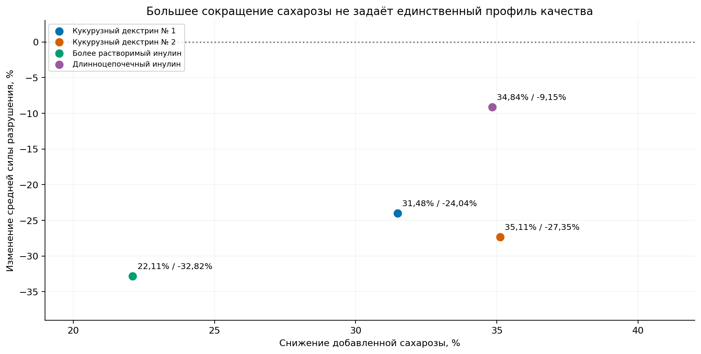

# Снижение добавленной сахарозы в песочном печенье

Проект № 3 аналитического портфолио. **Бизнес-вопрос: насколько можно снизить количество добавленной сахарозы за счёт пищевых волокон без существенного ухудшения измеренных характеристик качества?**

На кондитерском производстве сахар влияет на вкус, структуру, цвет и поведение теста при выпечке. Сравниваем четыре опубликованные рецептуры со стандартной и предлагаем направления дальнейших производственных испытаний. Согласованных границ допустимого ухудшения нет, поэтому описываем конкретные изменения, а технологическую эквивалентность не объявляем. Снижение добавленной сахарозы не равно измеренному снижению всех сахаров готового продукта.

**Аналитический этап выполнен:** воспроизводимая подготовка, анализ партийных средних, условные статистические сравнения, 11 визуализаций, сенсорные разности и таблица кандидатов. Интерактивный дашборд Yandex DataLens ещё не создан. Исходники и материалы аудита сохранены.

## Результаты сравнения

Все навески приведены на 100 г муки: это соотношение ингредиентов, а не массовая доля в готовом печенье. Масса нового коммерческого ингредиента не означает массу чистого пищевого волокна.

| Рецептура | Сахароза, г | Новый ингредиент, г | Снижение сахарозы | Средняя сила разрушения, Н | Изменение силы от стандарта |
|---|---:|---:|---:|---:|---:|
| Стандартная | 29,45 | 0 | 0% | 61,91 | 0% |
| Кукурузный декстрин № 1 | 20,18 | 9,27 | 31,48% | 47,03 | −24,04% |
| Кукурузный декстрин № 2 | 19,11 | 10,34 | 35,11% | 44,98 | −27,35% |
| Более растворимый инулин | 22,94 | 10,72 | 22,11% | 41,59 | −32,82% |
| Длинноцепочечный инулин | 19,19 | 10,26 | 34,84% | 56,24 | −9,15% |

Сила рассчитана с равным весом **трёх производственных партий** каждой рецептуры. Во всех вариантах среднее усилие излома ниже стандарта, но неопределённость велика. Ближайшее среднее усилие не означает сохранение всех характеристик.



Статический график из notebook. Точки представляют разные рецептуры и дозировки; зависимость качества от процента замены по ним не оценивается. Это не превью опубликованного BI-дашборда.

Для дальнейших испытаний выделены разные приоритеты, без общего рейтинга:

- **Кукурузный декстрин № 1:** снижение на 31,48% и меньшие среди вариантов сдвиги горечи и подгорелого вкуса по опубликованным средним: +5,67 и +5,94 пункта. Проверить изменение структуры и размеров.
- **Кукурузный декстрин № 2:** максимальное исследованное снижение, 35,11%; отдельные размеры и сопротивление проникновению близки по точечным оценкам. Сила ниже на 27,35%, подгорелый вкус выше на 27,62 пункта; необходимы дальнейшая проверка и сенсорная оптимизация.
- **Длинноцепочечный инулин:** отдельная ветка при приоритете усилия излома. При снижении сахарозы на 34,84% сила отличается на −9,15%, но проникновение — на +32,24%, число пиков — на −29,70%, длина — на −7,87%.
- **Более растворимый инулин:** сначала уточнить состав и повторить испытания. Его снижение сахарозы меньше, средняя сила ниже на 32,82%, а сводные вкусовые сдвиги выражены сильнее.

Сенсорные числа — разности интенсивностей по шкале 0–100, не потребительские предпочтения. Ни одна рецептура пока не доказана как эквивалентная стандарту или готовая к внедрению.

## Методы и границы выводов

Основная единица физического анализа — партийное среднее. Отдельные изделия и технические повторы вложены в партии. Номера `Replicate` не доказывают общие дни между рецептурами; парный дизайн не создаётся предположением.

Для основной метрики выполнены четыре двухсторонних Welch-сравнения с контролем и поправкой Holm. Из-за малого n и непроверенных предпосылок это **условный исследовательский анализ**, а не надёжное производственное доказательство. Наблюдаемые дисперсии различаются; ANOVA и корректная реализация Dunnett в SciPy показаны отдельно как чувствительность к допущению общей дисперсии. Не выбираем метод по тому, где p-value меньше.

Welch–Holm даёт скорректированные p-value примерно 0,395–0,564, Dunnett — 0,079–0,876. Все интервалы разностей включают ноль. **Отсутствие значимости не доказывает эквивалентность или отсутствие ухудшения.**

В notebook подписаны отдельные 95% t-интервалы средних, 98,75% интервалы Welch–Bonferroni с номинальным семейным уровнем 95% и совместные 95% интервалы Dunnett. Допущения и ограничения сохранены в CSV. У дополнительных физических показателей — описательные разности и партийные значения, без массового тестирования. По 40 сенсорным средним новых тестов нет; опубликованные результаты авторов атрибутированы отдельно.

## Материалы и подготовленные данные

Основной материал — [biscuit_recipe_analysis.ipynb](biscuit_recipe_analysis.ipynb): 13 последовательных разделов от объяснения ингредиентов до рекомендаций и инструкции DataLens. Все CSV пересчитываются при его выполнении.

| Файл | Строк | Уровень и назначение |
|---|---:|---|
| [recipes.csv](data/recipes.csv) | 5 | Состав, фактическое снижение сахарозы, исходные обозначения и флаг общей массы |
| [physical_measurements.csv](data/physical_measurements.csv) | 905 | Одно существующее измерение, источник/лист/ячейка, условная партия и флаги |
| [physical_batch_means.csv](data/physical_batch_means.csv) | 225 | Рецептура × партия × показатель; вход статистических расчётов |
| [physical_recipe_summary.csv](data/physical_recipe_summary.csv) | 75 | Рецептура × физический показатель; среднее, SD партий, контроль и разности; интервалы только основной метрики |
| [sensory_means.csv](data/sensory_means.csv) | 200 | Рецептура × опубликованный сенсорный признак; все 40 признаков и разности в пунктах |
| [metric_dictionary.csv](data/metric_dictionary.csv) | 56 | Русские названия, единицы, определения: 15 физических, 40 сенсорных и производный ΔE*76 |
| [statistical_results.csv](data/statistical_results.csv) | 8 | Четыре сравнения основной метрики × две модели; эффект, интервалы, p-value, n и допущения |
| [colour_summary.csv](data/colour_summary.csv) | 5 | Средние координаты цвета, расстояние ΔE*76, значение статьи и флаг расхождения |
| [candidate_comparison.csv](data/candidate_comparison.csv) | 4 | Снижение сахарозы, изменения качества, ограничения и направления испытаний |
| [bi_field_dictionary.csv](data/bi_field_dictionary.csv) | 234 | Все поля восьми логических BI-источников: тип, пропуски, описание, ключ и уровень строки |

Два из 15 физических показателей — контекстные массы групп до и после выпечки; они не включены в матрицу качества. ΔE*76 рассчитан как расстояние средних цветовых центров, без фиктивных партийных повторов, SD и интервалов.

Для точного сопоставления с источником:

| Название в проекте | Оригинальный ингредиент |
|---|---|
| Стандартная | Control, без заменителя |
| Кукурузный декстрин № 1 | Nutriose® FM06 |
| Кукурузный декстрин № 2 | Promitor® SGF 70R |
| Более растворимый инулин | Orafti® HSI |
| Длинноцепочечный инулин | Fibruline™ Instant |

Декстрины и инулиновые ингредиенты не объединены. Fibruline — растворимый инулин с цепочками разной длины; пользовательское название не означает исключительно длинные цепи.

Сохранены [отчёт аудита](audit_report.md), [исходные документы](source/), [их архив](source_files.zip), [опись Excel](audit/sheet_inventory.json), [извлечения для проверки](audit/) и [лицензионная информация](DATA_LICENSE.md). Аудит фиксирует состояние на 11 октября 2026 года; упоминания ещё не выполненного анализа относятся к этой дате. Актуальное состояние описано здесь и в notebook.

## Воспроизведение и проверки

Проверено на Python 3.12. Запустите из корня репозитория:

```bash
python -m pip install pandas==2.2.3 numpy==2.3.5 openpyxl==3.1.5 pdfplumber==0.11.9 python-docx==1.2.0 scipy==1.17.0 matplotlib==3.10.8 "jupyterlab>=4,<5"
jupyter lab biscuit_recipe_analysis.ipynb
```

Выполните все ячейки сверху вниз. Notebook читает локальные исходники по относительным путям, проверяет SHA-256, извлекает рецептурную таблицу из PDF, пересчитывает десять CSV и `analysis_overview.png`. Повторная загрузка из сети не нужна. Для численного расчёта Dunnett задан фиксированный генератор. CSV: UTF-8 с BOM, разделитель — запятая, десятичный знак — точка, отсутствующие значения — пустые.

Автоматические проверки контролируют пять рецептур, 15 условных партий, три партии на показатель, количество строк, состав и проценты сахарозы, отсутствие искусственных дат, ключи и связи, разрешённые знаменатели, уровень статистических расчётов и неизменность исходников. Соединения со справочниками проверяются на отсутствие размножения строк. Интервалы производственных средних и интервалы сравнений хранятся раздельно.

## Ограничения исходников

- В изломе на каждую рецептуру доступны 10/10/9 изделий по партиям; отсутствующие ячейки не восстановлены. Генерируемый ID обозначает запись измерения, а не глобальный ID печенья.
- Общая масса рецептуры более растворимого инулина — 180,16 г/100 г муки против 175,95 у остальных. Исходный состав не исправлен.
- Конфликтующие подписи размеров и силы сохранены с флагами; используемые мм и Н подтверждены статьёй. Реология и DP не включены из-за вопросов качества и независимости.
- Для длинноцепочечного инулина ΔE*76 из Excel составляет около 0,90 против 1,1 в статье. Обе версии сохранены. Не задаём границ видимости или приемлемости цвета.
- Индивидуальных сенсорных оценок нет; для одного признака `Dry` при четвёртом укусе отсутствует определение в S1. Опубликованные средние не превращены в независимые наблюдения.
- Тип и дозировка заменителя различаются вместе. Нет измерений всех сахаров готового печенья, потребительского предпочтения, хранения или экономики производства.

## Следующий этап — Yandex DataLens

Название: **«Как снижение сахарозы влияет на качество печенья»**. Данные и инструкция готовы; остаются сборка, проверка фильтров и агрегатов, публикация и скриншот.

План содержит пять блоков: состав и сахароза; сила разрушения; дополнительные физические характеристики; сенсорика; кандидаты и ограничения. Предусмотрены селектор рецептуры и выбор физического показателя. Разные единицы и уровни наблюдений не смешиваются.

`sensory_summary` использует существующий `sensory_means.csv`. Витрины соединяются со справочниками как «многие к одному»; физические и сенсорные наблюдения напрямую не соединяются. До присоединения статистики выбирается одна модель. Готовое контрольное значение сохраняет основу сравнения при фильтрации рецептуры. Подробные правила и проверки находятся в разделе 13 notebook и словаре полей.

## Источники

- [Набор Университета Рединга, DOI 10.17864/1947.000384](https://doi.org/10.17864/1947.000384).
- [Rodriguez-Garcia et al. (2022), LWT 167, 113837, DOI 10.1016/j.lwt.2022.113837](https://doi.org/10.1016/j.lwt.2022.113837).

Атрибуция, лицензия CC BY 4.0 и исходные ссылки: [DATA_LICENSE.md](DATA_LICENSE.md), [download_manifest.json](source/download_manifest.json).
