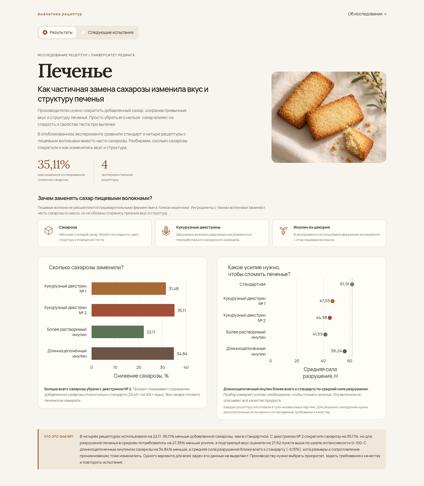

# Снижение добавленной сахарозы в печенье

**[Дашборд](https://cookies-alina-lab.streamlit.app/)** | **[Jupyter Notebook](biscuit_recipe_analysis.ipynb)**

## Цель исследования

Производителю важно уменьшить количество добавленной сахарозы и сохранить привычные вкус и структуру печенья. Сахар влияет не только на сладость, но и на цвет и свойства теста при выпечке. Поэтому в проекте сравниваю опубликованные рецептуры и выясняю, какие варианты стоит испытывать дальше.

## Данные

В [эксперименте Университета Рединга](https://doi.org/10.17864/1947.000384), описанном в [научной статье](https://doi.org/10.1016/j.lwt.2022.113837), сравнили стандартное печенье и четыре рецептуры с заменой части сахарозы. Для каждой рецептуры изготовили по три независимые партии. Для анализа использованы опубликованные экспериментальные данные. Собственные лабораторные измерения не проводились.

Отдельно сравнила кукурузные декстрины Nutriose и Promitor и инулиновые ингредиенты Orafti и Fibruline. Масса коммерческого ингредиента не равна массе чистого пищевого волокна.

## Основные результаты

- **В рецептуре с кукурузным декстрином № 2 сахарозу сократили на 35,11% — больше, чем в остальных вариантах.** Для разрушения печенья в среднем требовалось на 27,35% меньше усилия, а средняя оценка подгорелого вкуса была выше на 27,62 пункта, чем у стандарта.
- **С длинноцепочечным инулином средняя сила разрушения ближе всего к стандарту:** 56,24 Н против 61,91 Н (−9,15%). Сахарозы в рецептуре на 34,84% меньше, но размеры и сопротивление проколу отличаются от стандартных.
- **С декстрином № 1 оценки горечи и подгорелого вкуса отличаются от стандарта меньше всего:** +5,67 и +5,94 пункта. Это опубликованные средние. Речь об интенсивности ощущений по шкале 0–100, а не о предпочтениях покупателей.

Количество ингредиентов указано на **100 г муки**, а не на 100 г печенья. В стандартной рецептуре **29,45 г сахарозы**. Процент сокращения рассчитан относительно этой дозировки и не описывает изменение всех сахаров в готовом продукте.

## Дашборд

Две страницы, три графика и одна сравнительная таблица. На второй странице можно скачать сравнение рецептур в CSV.



## Ход работы

1. **Проверка данных.** Изучила описание эксперимента, проверила листы Excel, единицы измерения и пропуски. Отделила независимые производственные партии от измерений печенья внутри каждой партии.
2. **Подготовка таблиц.** Подготовила таблицы в pandas, сохранила ссылки на исходные ячейки, рассчитала средние по партиям и фактическое сокращение сахарозы.
3. **Исследовательский анализ.** Сравнила со стандартом механические свойства, размеры, влажность, цвет и опубликованные средние оценки дегустаторов.
4. **Статистический анализ.** Сравнила силу разрушения с помощью тестов Welch с поправкой Holm. Метод Dunnett использовала, чтобы проверить, насколько выводы зависят от допущений модели; по сводным оценкам дегустаторов новых тестов не проводила.
5. **Визуализация и рекомендации.** Собрала приложение на Streamlit и Plotly и предложила три направления следующих производственных испытаний.

## Рекомендации

Если главное — сильнее сократить сахарозу, стоит продолжить испытания **декстрина № 2**. Для близкой к стандарту силы разрушения интересен **длинноцепочечный инулин**, а для меньших изменений горечи и подгорелого вкуса — **декстрин № 1**. В повторных выпечках нужно проверить отмеченные различия по заранее согласованным требованиям к вкусу и структуре.

Сходство по отдельным показателям не означает, что продукт полностью повторяет стандарт. Три партии на рецептуру дают мало оснований для решения о внедрении, а допустимые изменения качества не определены. Индивидуальные оценки дегустаторов не опубликованы, а общее содержание сахаров готового печенья не измерялось. Тип и дозировка заменителя меняются вместе, а общая масса ингредиентов в рецептуре Orafti больше, чем в остальных. Отсутствие статистически значимого различия не доказывает одинаковое качество.

## Инструменты

Python, pandas, NumPy, SciPy, Matplotlib, Jupyter Notebook, Plotly, Streamlit.

## Запуск

Python 3.12, Windows PowerShell из корня проекта:

```powershell
py -3.12 -m venv .venv-app
.\.venv-app\Scripts\python.exe -m pip install -r requirements.txt
.\.venv-app\Scripts\python.exe -m streamlit run app.py
```

Откройте `http://localhost:8501`. На Linux/macOS используйте `.venv-app/bin/python`. Приложение читает готовые CSV и не требует исходных документов, ключей или внешней базы данных.

## Повторение анализа

Как установить библиотеки и выполнить анализ, описано в начале notebook. При первом запуске он скачивает шесть документов по официальным ссылкам в локальную `source/`, исключённую из Git, и проверяет SHA-256. Если сервер недоступен, документы нужно скачать вручную по ссылкам и сохранить под именами из [манифеста](data/source_manifest.json). Подготовленные CSV сохранены в репозитории. Авторство и условия CC BY 4.0 указаны в [лицензии данных](data/DATA_LICENSE.md).
