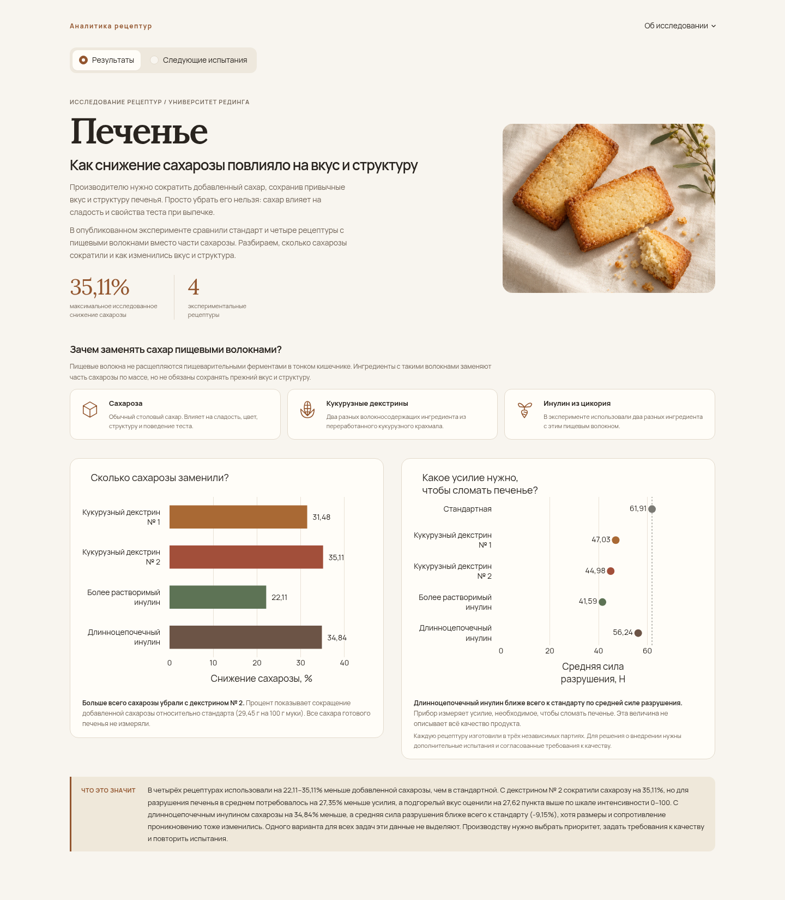

# Снижение добавленной сахарозы в печенье: анализ экспериментальных рецептур

**[Открыть интерактивный дашборд](https://cookies-alina-lab.streamlit.app/)** · **[Посмотреть Jupyter Notebook](biscuit_recipe_analysis.ipynb)**

## Бизнес-задача

Производителю нужно уменьшить добавленный сахар, сохранив привычные вкус и структуру печенья. Просто убрать сахар нельзя: он влияет на сладость, цвет и поведение теста при выпечке.

В проекте сравниваю стандартную рецептуру с четырьмя вариантами, где часть сахарозы заменили ингредиентами с пищевыми волокнами. Цель — оценить изменения продукта и предложить рецептуры для следующих производственных испытаний. Универсальный допустимый процент снижения сахара эти данные не устанавливают.

## Основные результаты

- **Самое большое сокращение сахарозы — 35,11% с кукурузным декстрином № 2.** Но для разрушения печенья в среднем потребовалось на 27,35% меньше усилия, а подгорелый вкус оценили на 27,62 пункта выше стандарта.
- **Длинноцепочечный инулин ближе всего к стандарту по средней силе разрушения.** Сахарозы на 34,84% меньше; сила — 56,24 Н против 61,91 Н у стандарта (−9,15%). При этом печенье стало короче, а сопротивление проникновению выросло.
- **С кукурузным декстрином № 1 горечь и подгорелый вкус изменились меньше, чем с другими заменителями:** +5,67 и +5,94 пункта. Это интенсивность ощущений по шкале 0–100, а не потребительские оценки вкусности.
- **Единственной рецептуры для внедрения пока нет.** Близость по одному показателю не означает сохранения всех свойств. Перед внедрением нужны согласованные требования к качеству и дополнительные испытания.

Проценты относятся к **добавленной сахарозе в рецептуре**. Стандарт — 29,45 г сахарозы на 100 г муки; это не содержание сахара в 100 г готового печенья.

## Исходные данные

[Опубликованный набор Университета Рединга](https://doi.org/10.17864/1947.000384) и [статья Rodriguez-Garcia et al., 2022](https://doi.org/10.1016/j.lwt.2022.113837). Пять рецептур, по три независимые производственные партии. Это анализ чужого опубликованного эксперимента; лабораторные измерения автор портфолио не проводил.

В исследованных вариантах сахарозы на **22,11–35,11%** меньше, чем в стандарте. Два кукурузных декстрина — Nutriose и Promitor; два инулиновых ингредиента — Orafti и Fibruline. Они анализируются раздельно. Коммерческий ингредиент не равен чистому пищевому волокну. [Оригиналы и манифест](source/) сохранены без изменения, лицензия — [CC BY 4.0](DATA_LICENSE.md).

## Дашборд

[Приложение «Печенье»](https://cookies-alina-lab.streamlit.app/) показывает снижение сахарозы, силу разрушения и два вкусовых признака. На второй странице — сравнение четырёх кандидатов, рекомендации и скачивание CSV. Всего две страницы, три графика и одна таблица.



Скриншот локальной версии. Источники и ограничения в приложении доступны в кнопке «Об исследовании».

## Ход исследования

1. **Постановка вопроса.** Разобрала дизайн [опубликованного эксперимента](source/) и отделила снижение сахарозы в рецептуре от содержания всех сахаров готового продукта.
2. **Аудит измерений.** Проверила листы Excel, единицы, пропуски и связь повторов с партиями. Зафиксировала конфликтующие подписи и ограничения в [отчёте аудита](audit_report.md).
3. **Подготовка данных.** В pandas извлекла существующие измерения с происхождением до ячейки, рассчитала [партийные средние](data/physical_batch_means.csv) и фактическое сокращение сахарозы. Пропуски не восстанавливала.
4. **Сравнение рецептур.** По трём партийным средним оценила разности с контролем и неопределённость. В [notebook](biscuit_recipe_analysis.ipynb) — Welch-сравнения с поправкой Holm и анализ чувствительности методом Dunnett. По опубликованным сенсорным средним новых тестов нет.
5. **Представление результатов.** Связала измерения с направлениями следующих испытаний и собрала [приложение на Streamlit и Plotly](app.py), которое читает подготовленные CSV и не пересчитывает статистику.

## Рекомендации

- **Декстрин № 2**, если приоритет — сильнее сократить сахарозу. При следующей выпечке проверить силу разрушения и подгорелый вкус по согласованным требованиям.
- **Длинноцепочечный инулин**, если важна близость к стандартной силе разрушения. Дополнительно проверить размеры и сопротивление проникновению.
- **Декстрин № 1**, если важны меньшие изменения горечи и подгорелого вкуса. Повторить оценку вкуса, силы разрушения и высоты печенья.

Это направления испытаний, а не рейтинг качества или готовые производственные решения.

## Ограничения

- Всего три независимые партии на рецептуру. Отдельные печенья не увеличивают число производственных повторов; статистические выводы зависят от допущений.
- Допустимые изменения качества не заданы. Отсутствие значимых различий не доказывает одинаковое качество.
- Нет измерений всех сахаров готового печенья и индивидуальных сенсорных оценок. Нельзя оценить потребительскую привлекательность, срок хранения или экономику внедрения.
- Тип и дозировка заменителя меняются одновременно. У более растворимого инулина общая масса рецептуры — 180,16 против 175,95 г на 100 г муки у остальных; исходный состав не исправлен.

## Инструменты

Python 3.12, pandas, NumPy, SciPy, Matplotlib, Jupyter Notebook, Plotly и Streamlit. В приложении используются только pandas, Plotly и Streamlit.

## Локальный запуск

Windows PowerShell, из корня репозитория:

```powershell
py -3.12 -m venv .venv-app
.\.venv-app\Scripts\python.exe -m pip install -r requirements.txt
.\.venv-app\Scripts\python.exe -m streamlit run app.py
```

Откройте `http://localhost:8501`. Активация окружения, ключи и внешняя база данных не нужны. На Linux/macOS используйте Python 3.12 и путь `.venv-app/bin/python`.

## Дополнительные материалы

- [Источники, структура данных, инвентаризация и воспроизведение](docs/project_notes.md).
- [Аудит исходных данных](audit_report.md) и [лицензии](DATA_LICENSE.md).
- [График с партийными значениями и неопределённостью](analysis_overview.png).

Проверки: **13 автоматических тестов**, полное выполнение notebook в отдельной копии и одна браузерная smoke-проверка на 1440, 1024 и 390 px. Команды и границы проверки описаны в технических заметках.
