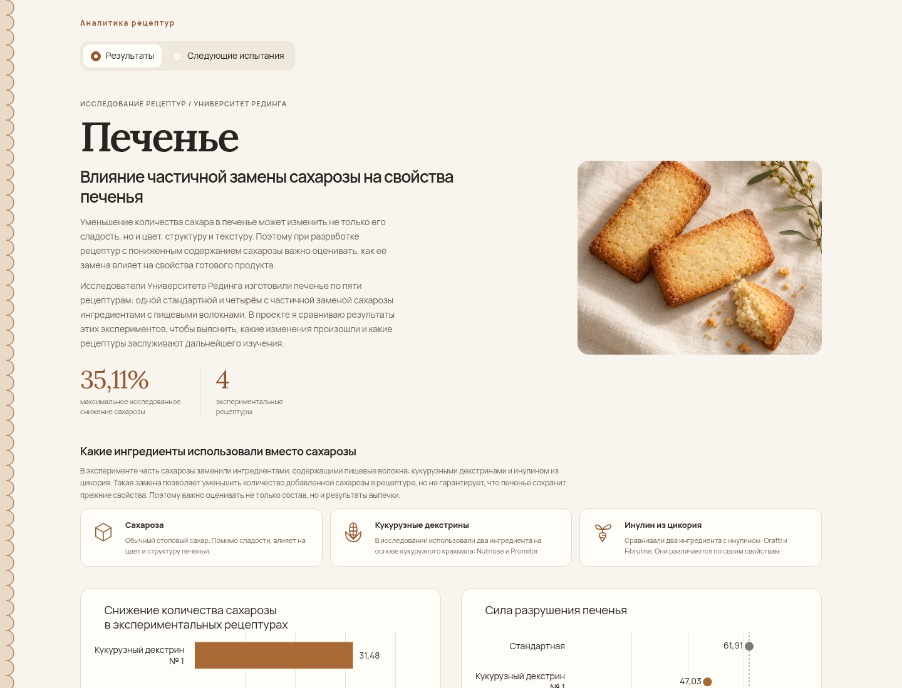
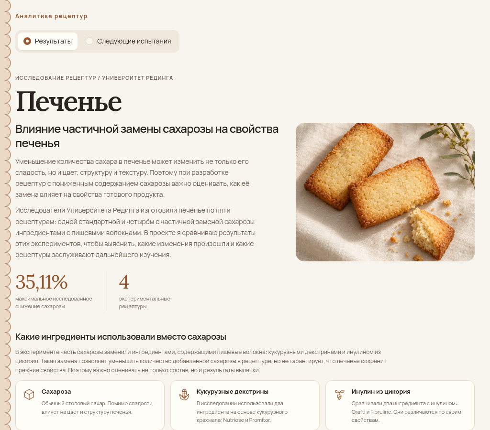
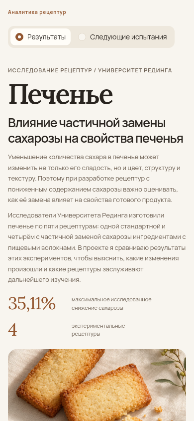
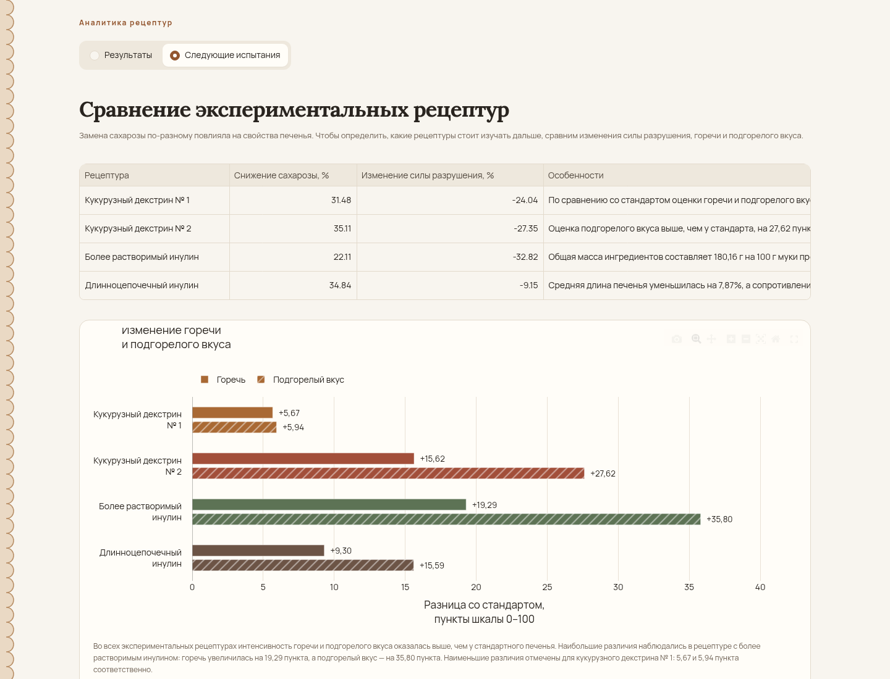
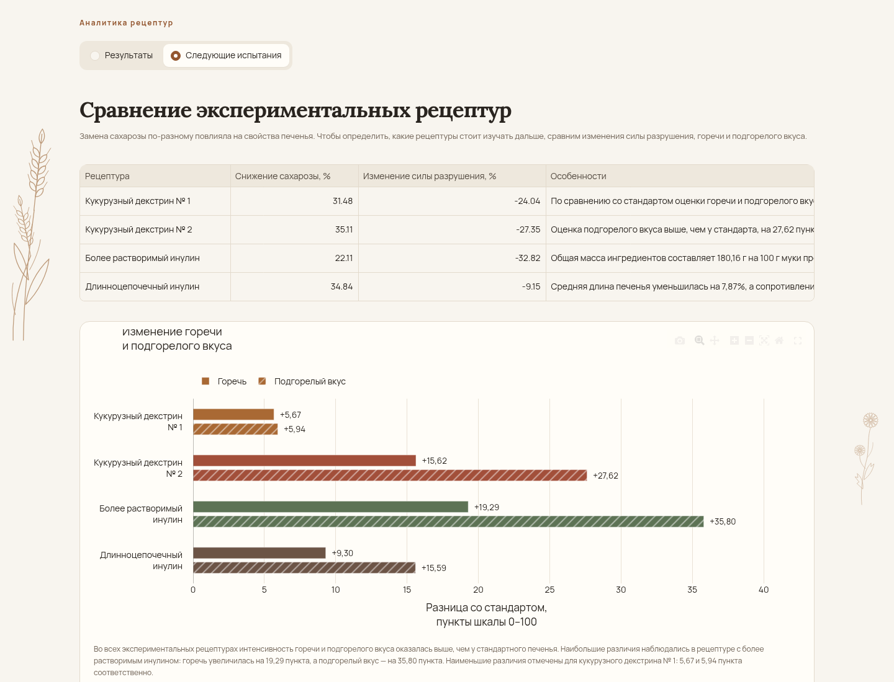
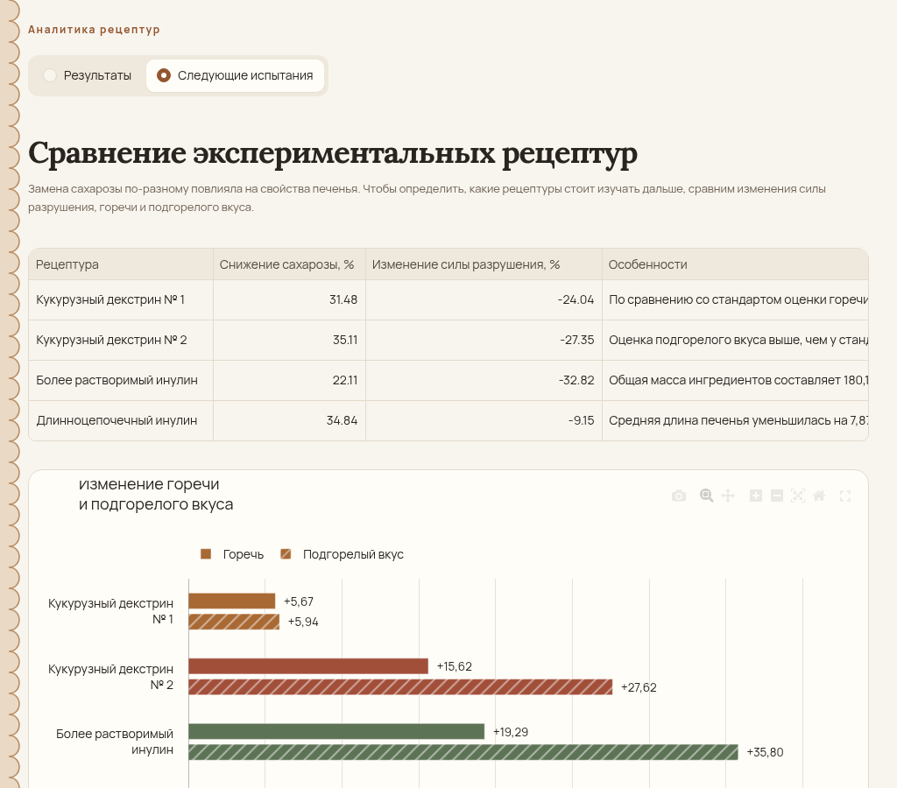
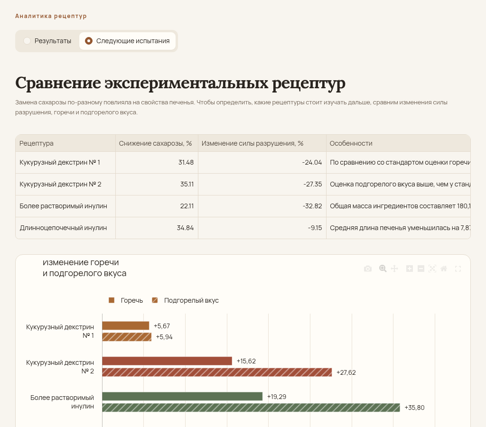
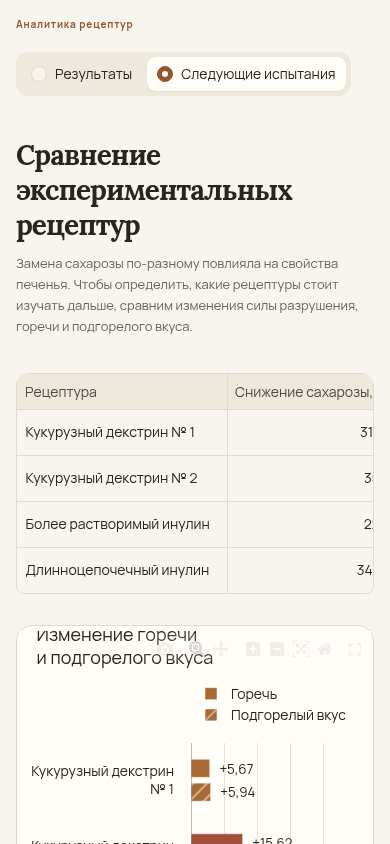

# Cookies: боковое оформление — до и после

Реальные скриншоты локального приложения в Chromium. Облачную публикацию визуально подтвердить не удалось: браузер среды получил `ERR_CERT_AUTHORITY_INVALID`. Проверка TLS не отключалась.

До: [`5b1d7d8`](https://github.com/Alina-lab/cookies/commit/5b1d7d84794cf7a17dbfc86f329907c603100cc9). После: [`8c4c5ea`](https://github.com/Alina-lab/cookies/commit/8c4c5ea9370c372c0e0f3a5d13cd621992f3761c).

Слева — два контурных колоса; справа — меньшая веточка цикория. SVG встроены через CSS, не занимают места в разметке и не перехватывают нажатия. При ширине меньше 1360 px оба рисунка скрыты.

| Ширина окна | Ширина содержимого до / после | Боковые поля | Декор после |
|---|---|---|---|
| 1440 px | 1184 / 1184 px | по 128 px | Видим с обеих сторон |
| 1024 px | 960 / 960 px | по 32 px | Скрыт |
| 390 px | 358 / 358 px | по 16 px | Скрыт |

Для обеих страниц совпали геометрия содержимого, данные и настройки Plotly, а также пользовательский текст. Прошли 14 автоматических тестов и браузерная smoke-проверка: переключение страниц, три графика и подсказки, таблица, CSV, изображения и шрифты. Горизонтальной прокрутки страницы и ошибок JavaScript не обнаружено. На граничной ширине 1360 px между декором и содержимым осталось 12 px слева и 18 px справа.

Изображения сохранены в исходном разрешении. Размеры окон: 1440 × 1100, 1024 × 900 и 390 × 844 px. Это снимки видимой области страницы; графики и карточки ниже проверены при прокрутке.

Материалы сравнения хранятся только в ветке `visual-review-botanical`. Основная ветка `main` содержит пять необходимых файлов исправления без этих проверочных изображений.

## Результаты

### 1440 px

| До | После |
|---|---|
|  |  |

[До — исходный PNG](botanical-before-results-1440.png) · [После — исходный PNG](botanical-after-results-1440.png)

### 1024 px

| До | После |
|---|---|
|  |  |

[До — исходный PNG](botanical-before-results-1024.png) · [После — исходный PNG](botanical-after-results-1024.png)

### 390 px

| До | После |
|---|---|
|  |  |

[До — исходный PNG](botanical-before-results-390.png) · [После — исходный PNG](botanical-after-results-390.png)

## Следующие испытания

### 1440 px

| До | После |
|---|---|
|  |  |

[До — исходный PNG](botanical-before-candidates-1440.png) · [После — исходный PNG](botanical-after-candidates-1440.png)

### 1024 px

| До | После |
|---|---|
|  |  |

[До — исходный PNG](botanical-before-candidates-1024.png) · [После — исходный PNG](botanical-after-candidates-1024.png)

### 390 px

| До | После |
|---|---|
|  |  |

[До — исходный PNG](botanical-before-candidates-390.png) · [После — исходный PNG](botanical-after-candidates-390.png)
