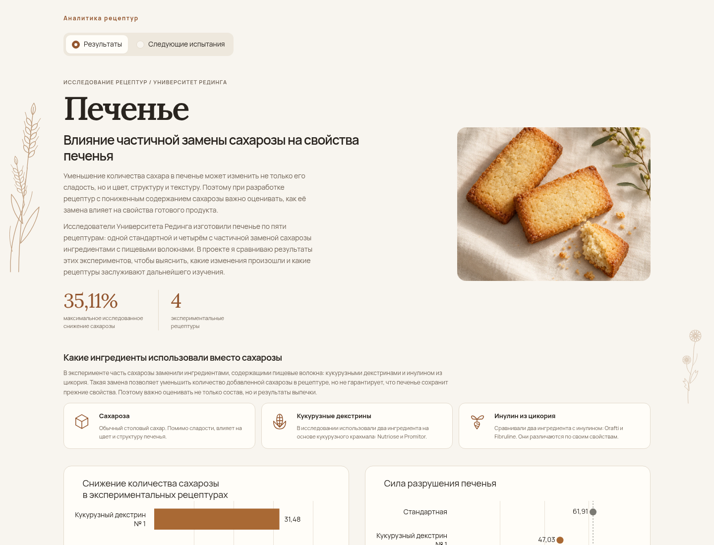
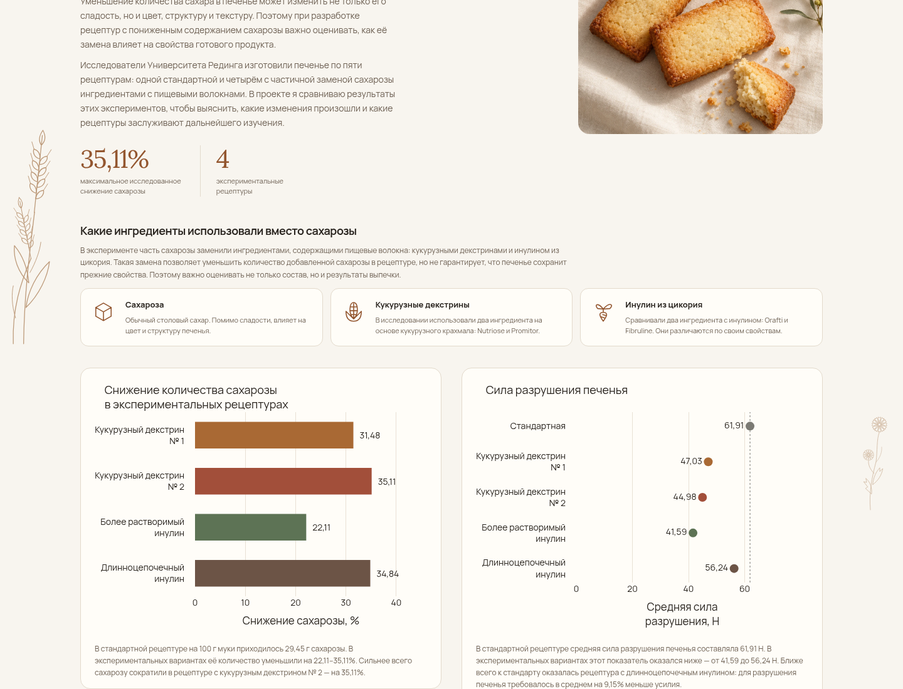
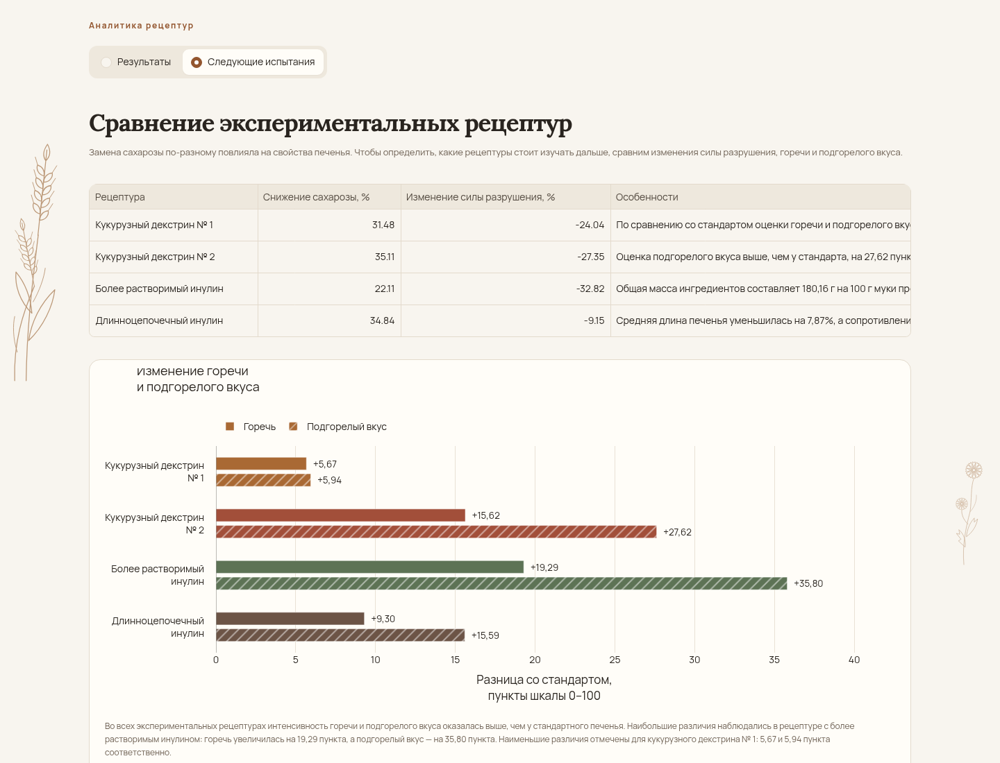
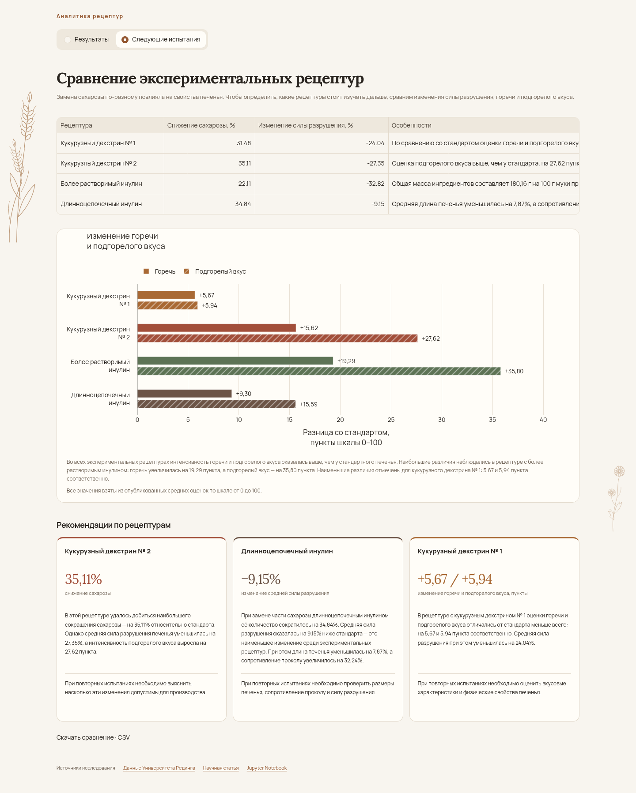
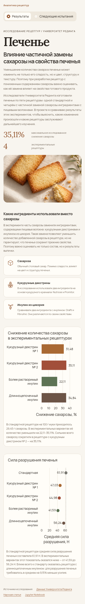
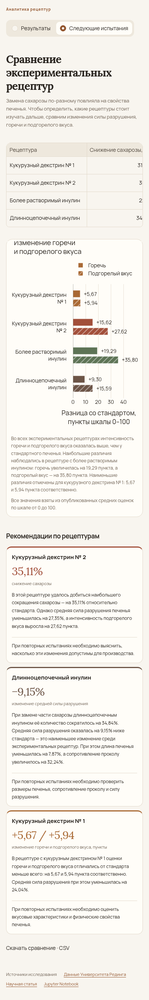

# Печенье: итоговая визуальная проверка

Снимки настоящего локального приложения в Chromium. Версия кода: [`c52443b`](https://github.com/Alina-lab/cookies/commit/c52443b4f00175d76d9108b20dfe27aff8563c72).

Все 15 Python-тестов прошли, в том числе в чистом Python 3.12 после установки `pip install -r requirements.txt`. `pip check` не нашёл проблем. Браузер проверил обе страницы на 1440, 1360, 1024, 768 и 390 px: всего 10 сочетаний. Проверены графики и подсказки, карточки, источники, иллюстрации, шрифты и SVG. Таблица прокручивается внутри контейнера, CSV скачивается и совпадает с исходными значениями. Ошибок Streamlit и JavaScript, горизонтальной прокрутки страницы и перекрытий содержимого не обнаружено.

Первая карточка сохранена дословно. Все три карточки имеют одинаковую структуру; на широких экранах выровнены показатели и нижние заключения. На 768 px графики и рекомендации стоят друг под другом. Два ботанических SVG не изменялись и скрываются при ширине менее 1360 px. Notebook и все CSV не изменялись.

Облачную версию сравнить с локальной не удалось: браузер среды получил ошибку проверки сертификата. Проверка TLS не отключалась. Эти снимки подтверждают локальную отрисовку, а не обновление Streamlit Community Cloud.

В `main` сохранено одно актуальное превью. Остальные шесть изображений находятся только в ветке `final-review-20261015`. Полные снимки получены в высоком окне браузера той же ширины, без изменения CSS; ширина — 1440 или 390 px.

## Первая страница целиком

## Первый экран на десктопе

[Открыть исходный PNG](final-results-1440.png)

## Оба графика первой страницы

[Открыть исходный PNG](final-results-charts-1440.png)

## Сравнительная таблица

[Открыть исходный PNG](final-candidates-1440.png)

## Вторая страница целиком: таблица, вкус, рекомендации и источники

[Открыть исходный PNG](final-candidates-full-1440.png)

## Первая страница на смартфоне, целиком

[Открыть исходный PNG](final-results-full-390.png)

## Вторая страница на смартфоне, целиком

[Открыть исходный PNG](final-candidates-full-390.png)
